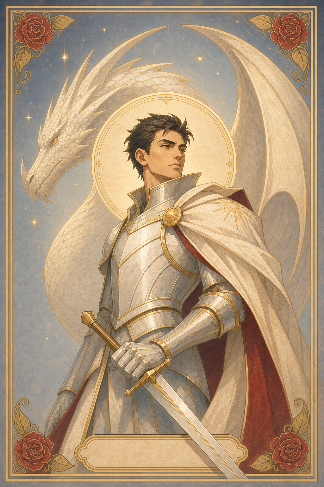

# 命运之轮：你的西幻职业

一款面向移动端的沉浸式西幻职业性格测试。用户完成 28 道情境选择题后，系统会从两组人格维度中计算主要倾向，组合得到 16 种职业之一，并通过可翻转的塔罗牌展示人物画像、性格偏好与完整职业解析。



## 项目亮点

- 28 道同情境、同层级的行为选择题，减少选项不可比较的问题。
- 两组独立人格维度：核心驱动力与关系倾向，各 14 道题。
- 4 × 4 组合映射为 16 种西幻职业。
- 16 张统一视觉体系的塔罗牌职业画像。
- 完整展示命运宣言、职业介绍、灵魂本质与命运寄语。
- 适配手机端，包含进度、返回修改、命运仪式和 3D 翻牌动画。
- 零框架、零运行时依赖，可直接部署为静态网站。

## 人格模型

| 维度组 | 倾向 | 含义 |
| --- | --- | --- |
| 核心驱动力 | 勇气、求知、创造、洞察 | 面对问题时更自然的行动方式 |
| 关系倾向 | 共情、自然、联结、独立 | 与他人、环境和责任建立关系的方式 |

最终职业由两组中得分最高的倾向共同决定。例如“勇气 + 自然”对应“驭兽师”，“洞察 + 独立”对应“占星师”。测试用于娱乐与自我探索，不构成心理学诊断或职业规划结论。

## 本地运行

本项目不需要安装依赖。进入项目目录后启动任意静态服务器：

```powershell
python -m http.server 4173 --directory dist
```

然后访问 <http://127.0.0.1:4173>。

## 自动质检

需要 Node.js 18 或更高版本：

```powershell
npm test
```

质检脚本会检查：

- 题目总数及两组维度是否各为 14 道。
- 每道题是否包含四个互不重复、属于同一维度组的选项。
- 16 种职业组合、长文解析和塔罗牌资源是否完整。
- 源文件与 `dist` 发布目录是否一致。
- 页面入口、结果章节与脚本引用是否正确。

## 项目结构

```text
.
├─ assets/cards/             # 16 张职业塔罗牌原图
├─ dist/                     # 可直接部署的静态成品
├─ docs/                     # 架构、路线图与 AI 协作记录
├─ scripts/validate-project.cjs
├─ .github/                  # 自动质检与 Issue 模板
├─ app-v2.js                 # 题库、计分与结果数据
├─ index.html                # 页面结构
├─ styles.css                # 主视觉样式
└─ overrides.css             # 画像与长文结果样式
```

详细设计见 [docs/ARCHITECTURE.md](docs/ARCHITECTURE.md)，版本规划见 [docs/ROADMAP.md](docs/ROADMAP.md)。

## 建议的首个 GitHub Milestone

仓库上传后创建 `v1.0 · 性格测试 MVP`，将以下任务加入该 Milestone：

1. 题目选项并列性重构
2. 两组维度计分校准
3. 16 种职业完整解析接入
4. 塔罗牌翻转结果页
5. 手机端视觉与长文排版验收
6. 自动质量检查与发布快照

完成后创建 `v1.0.0` 标签和 GitHub Release，形成可复核的固定快照。

## 内容与版权

职业文案、测试结构及项目代码用于本项目。人物画像为项目定制视觉素材。未经项目所有者许可，不得复制、转售或用于其他商业产品。

